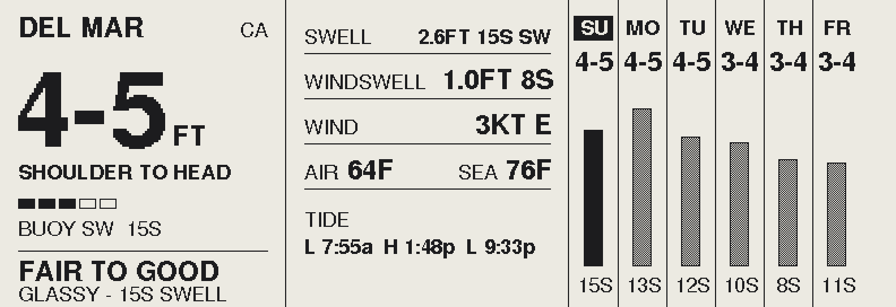
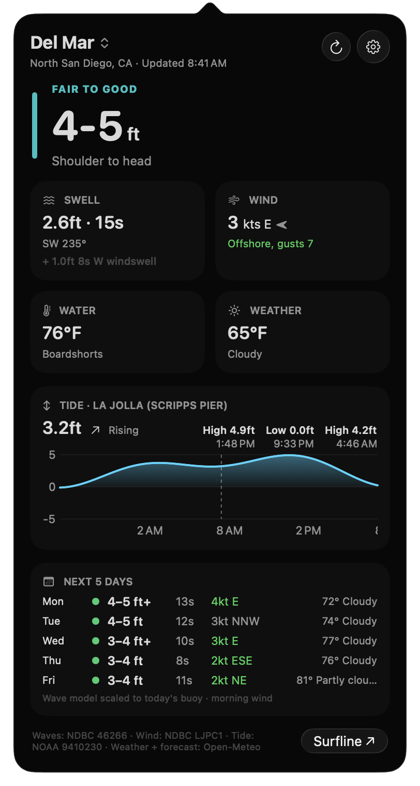

<h1 align="center">SwellStrip</h1>

<p align="center">A surf report that lives on your desk. One glance, no phone.</p>

<p align="center"></p>

<p align="center"><sub>The actual frame from the display (read out of its framebuffer), Del Mar, Nov 1 2026.</sub></p>

SwellStrip is a 5.79" e-paper strip that shows the surf at your beach: today's size and
rating, the swell, wind, air and water temperature, the tides, and a six-day outlook. It
wakes on the hour, pulls fresh buoy readings, redraws, and goes back to sleep. Press any
button on the front to refresh it now.

It has a sibling on the Mac: **[Swellbar](https://github.com/Jamesborlands/swellbar)**, a
menu bar app. Both use the same data and the same math, so the desk and the laptop never
disagree, and both are tuned to read like Surfline.

## Two screens, one forecast

<table>
<tr>
<td width="50%" valign="top">

**SwellStrip** (this repo)<br>
E-paper on the desk. Always on, sips power, updates hourly.


</td>
<td width="50%" valign="top">

**[Swellbar](https://github.com/Jamesborlands/swellbar)**<br>
The same report in the Mac menu bar.


<picture><source media="(prefers-color-scheme: light)" srcset="docs/swellbar-popover-light.png"></picture>

</td>
</tr>
</table>

## What's on the screen

| Column | Shows |
|---|---|
| **Headline** | Spot, surf height (`4-5 FT`), body height (`SHOULDER TO HEAD`), a 5-bar size meter, the buoy's swell direction and period, the rating (`FAIR TO GOOD`) and why (`GLASSY - 15S SWELL`) |
| **Details** | Primary swell, wind swell, wind speed and direction, air and sea temperature, today's tides |
| **Outlook** | Today plus five days: surf range, a bar for size (solid for today), and the swell period |

The rating runs Flat, Very Poor, Poor, Poor to Fair, Fair, Fair to Good, Good, Epic. Size
sets the starting point, long-period swell bumps it up, and onshore or cross-shore wind
knocks it down.

## Hardware

| Part | Notes |
|---|---|
| [Elecrow CrowPanel 5.79" E-paper HMI Display](https://www.elecrow.com/crowpanel-esp32-5-79-e-paper-hmi-display-with-272-792-resolution-black-white-color-driven-by-spi-interface.html) | 792 x 272 black and white e-paper, ESP32-S3-WROOM-1-N8R8 (8 MB flash, 8 MB PSRAM), WiFi, MENU and EXIT buttons plus a rotary switch, USB-C. Everything is on the one board. |
| USB-C cable | For power and for flashing |

That's it. No soldering, no wiring. The panel keeps its picture with the power off, and the
ESP32 deep sleeps between updates.

## Data

All free, no accounts, no API keys.

| What | Source |
|---|---|
| Surf height | [NDBC 46266](https://www.ndbc.noaa.gov/station_page.php?station=46266) Del Mar Nearshore buoy, spectral summary |
| Swell and wind swell | Same buoy |
| Wind | [NDBC LJPC1](https://www.ndbc.noaa.gov/station_page.php?station=LJPC1) Scripps Pier, or [Open-Meteo](https://open-meteo.com) if it's down |
| Tides | [NOAA CO-OPS 9410230](https://tidesandcurrents.noaa.gov/stationhome.html?id=9410230) La Jolla |
| Air temperature | Open-Meteo Forecast |
| Six-day outlook | [Open-Meteo Marine](https://open-meteo.com/en/docs/marine-weather-api), scaled to match today's buoy |

If the buoy is down, the wave model stands in for it.

## How the surf height is worked out

A buoy measures waves out in open water. What you see at the beach is the height where they
break, which is bigger for long-period swell. SwellStrip turns the buoy's numbers into a
breaking height with the Komar-Gaughan formula:

```
Hb = 0.39 * g^0.2 * (T * H^2)^0.4 * calibration
```

It uses the **swell** part of the buoy's reading (not the total, which includes short-period
wind chop), averages the last 2 hours of readings so the number doesn't jump around, and
then rounds into Surfline-style ranges (`2-3`, `3-4+`, `4-5`...).

The calibration was fitted against Surfline's hourly Del Mar reports, on a day of mixed small
swell (2-3 ft) and a day of clean 15 second southern hemi groundswell (4-5 ft). Both land in
the same range Surfline showed. Swellbar's
[`SurfMath.swift`](https://github.com/Jamesborlands/swellbar/blob/main/Sources/SurfMath.swift)
uses the same constants; change one, change both.

## Build and flash

1. Install the [Arduino IDE](https://www.arduino.cc/en/software) and add the ESP32 boards
   (Boards Manager: **esp32** by Espressif).
2. Install these libraries from the Library Manager:
   - **GxEPD2** by Jean-Marc Zingg
   - **Adafruit GFX** by Adafruit
   - **ArduinoJson** by Benoit Blanchon (v7)
3. Copy `SwellStrip/secrets.example.h` to `SwellStrip/secrets.h` and put in your WiFi name
   and password. `secrets.h` is gitignored.
4. Open `SwellStrip/SwellStrip.ino` and pick these board settings:

   | Setting | Value |
   |---|---|
   | Board | ESP32S3 Dev Module |
   | USB CDC On Boot | Disabled (the board has a USB-serial chip) |
   | Flash Size | 8MB |
   | PSRAM | OPI PSRAM |
   | Partition Scheme | 8M with spiffs (3MB APP/1.5MB SPIFFS) |

5. Plug the panel in over USB-C and click Upload.

Or from the command line with `arduino-cli`:

```sh
arduino-cli compile -u -p /dev/cu.wchusbserial* \
  --fqbn "esp32:esp32:esp32s3:CDCOnBoot=default,FlashSize=8M,PartitionScheme=default_8MB,PSRAM=opi" \
  SwellStrip
```

On a Mac the port shows up as `/dev/cu.wchusbserial...` once the
[WCH CH34x driver](https://www.wch-ic.com/downloads/CH34XSER_MAC_ZIP.html) is installed. The
serial monitor at 115200 baud prints what it fetched on each wake.

## Make it yours

Everything you'd change is at the top of `SwellStrip.ino`:

| Constant | What it is |
|---|---|
| `SPOT_NAME`, `SPOT_REGION`, `SPOT_LAT`, `SPOT_LON` | Your beach |
| `WAVE_BUOY` | Nearest [NDBC](https://www.ndbc.noaa.gov/obs.shtml) wave buoy that reports spectral data |
| `WIND_STATION` | Nearest NDBC station with wind |
| `TIDE_STATION` | Nearest [NOAA tide station](https://tidesandcurrents.noaa.gov/map/) |
| `BEACH_FACING_DEG` | The way you face when you look at the waves. Decides which wind is offshore. |
| `TZ_INFO` | Your time zone |
| `OUTLOOK_AS_LINE` | Draw the outlook as a line instead of bars |

The calibration is tuned for Del Mar. Other beaches may read a little high or low.

## How it runs

- Wakes at the top of every hour, refreshes, and deep sleeps until the next hour.
- Any front button (MENU, EXIT, or the rotary switch) wakes it to refresh now. The LED is
  lit while it works.
- A full ghost-clearing refresh happens on power-on and at 4 am; the rest are quick updates.
- If WiFi or the data is down, it says so on the screen instead of showing stale numbers.

## License

[MIT](LICENSE)
